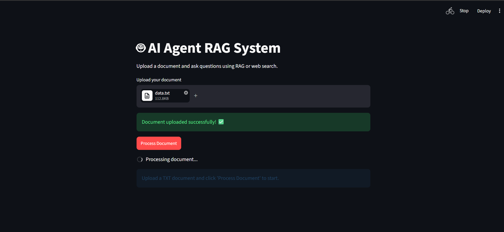
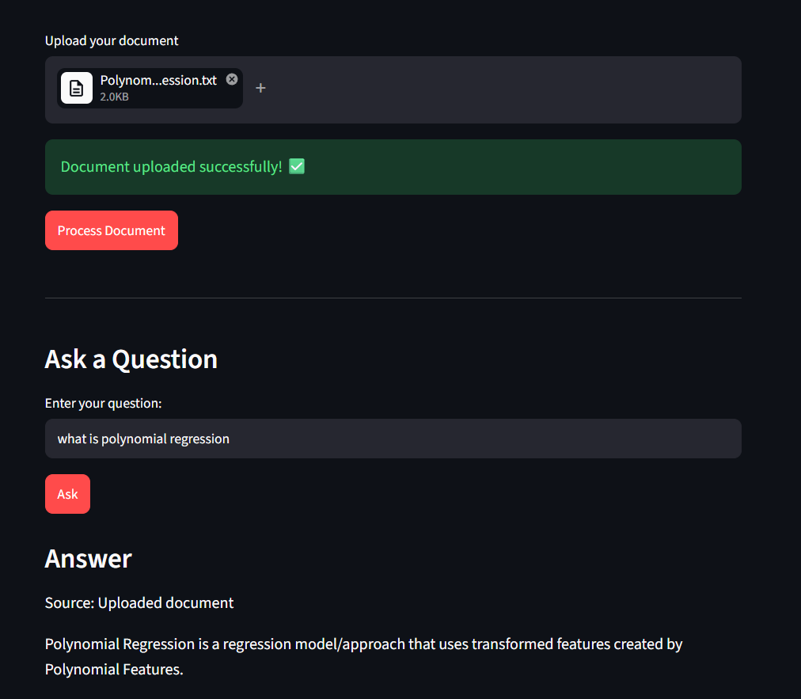
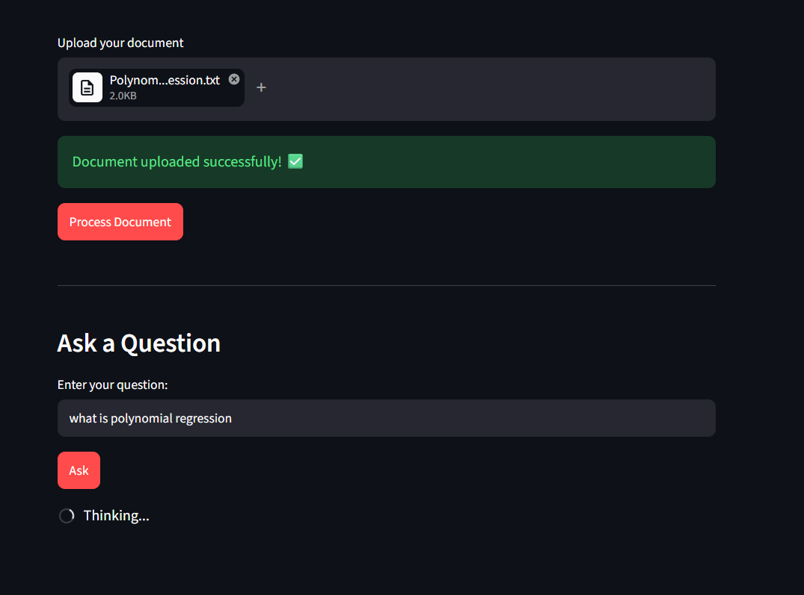
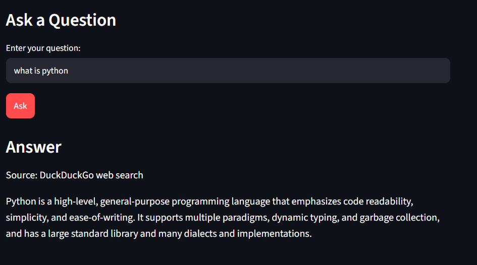

# DuckDuckGo AI RAG Agent

This project is a small AI application that combines:

- a document-based retrieval pipeline using FAISS and embeddings
- document-match routing that chooses the uploaded file or the web
- a web search tool using DuckDuckGo
- a Streamlit interface for uploading a text document and asking questions

It is built around a LangGraph workflow, with the logic split across the main app, the agent orchestration, and the RAG pipeline.

## Project structure

- `main.py` – Streamlit frontend for uploading a document and asking questions
- `agent.py` – LangGraph agent, decision routing, web search tool, final answer generation
- `rag.py` – document preprocessing, chunking, embeddings, FAISS vector store, retrieval logic

## How it works

1. The user uploads a `.txt` document in the Streamlit app.
2. The app calls `create_rag(data)` in `rag.py`.
3. The document is split into chunks, embedded, and stored in a FAISS vector database.
4. When the user asks a question, the app checks how closely it matches the uploaded document.
5. A close match is answered from the document. Otherwise, DuckDuckGo searches the web.
6. Each answer shows whether it came from the uploaded document or DuckDuckGo web search.

## Features

- Upload and process local text documents
- ChatGPT-style chat interface with a **+** button for TXT uploads
- Query the document using semantic retrieval
- Answer from document chunks when they contain the answer
- Automatically fall back to DuckDuckGo when the document does not answer the question
- Show the source of every answer
- Use a LangGraph workflow for routing between tasks
- Run through a simple Streamlit UI

## Requirements

Install the Python packages required by the project, including:

```bash
pip install streamlit langchain_ollama langchain_core langgraph ddgs langchain_text_splitters langchain_community langchain_huggingface huggingface_hub contractions spacy
```

You will also need:

- Ollama installed and running locally
- an Ollama model available such as `llama3.1`
- the spaCy English model downloaded:

```bash
python -m spacy download en_core_web_sm
```

Hugging Face may download the embedding model the first time the app processes a document.

## Run the app

From the project directory:

```bash
streamlit run main.py
```

Then:

1. upload a text file
2. click `Process Document`
3. ask a question in the input box
4. click `Ask`

## Notes

- The app is designed for `.txt` files only.
- The `ddgs` package is used for general web queries outside the uploaded document.
- The retrieval logic relies on embeddings and semantic similarity to find the most relevant document chunks.
- The code is a prototype/demo application and may need tuning for production use.

## Screenshots

### Upload and process a document

Upload a TXT file, then click **Process Document** to create the searchable document index.



### Ask a question about the document

Questions answered from the uploaded content are labelled **Source: Uploaded document**.



### Answering a question

The app displays a short loading message while it retrieves the best matching chunks and generates an answer.



### DuckDuckGo fallback

If the uploaded document does not contain the answer, the app searches DuckDuckGo and labels the result **Source: DuckDuckGo web search**.



## Example workflow

```text
Upload: company_policy.txt
Question: What are the first three steps in the onboarding process?

Document match is strong
Retrieval finds relevant chunks from the uploaded text
Answer source: Uploaded document
```

```text
Upload: unrelated document
Question: What is the capital of France?

Document does not contain an answer
DuckDuckGo search returns sources
Answer source: DuckDuckGo web search
```
